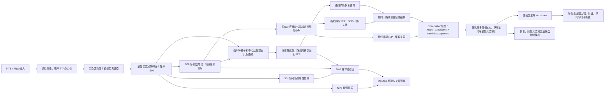

# LensAgent 视觉处理流程

这份文档是项目唯一的固定视觉流程说明。流程架构不会随样本变化，因此不再向每个对象的输出目录重复写入同一张流程图。

## 边界

- 视觉层负责记录“看到了什么、测量到什么”；
- 视觉层不直接输出透镜或非透镜结论；
- 原始SEP像素完整保存；同一连通块会被拆成路线内与路线外局部部分，二者都不会因分流而从追溯记录中删除；
- 几何路径由SEP种子与中心后备模式共同提出；路线只提示再次搜索的位置；
- 路线内仍由SEP在真实残差/RMS上检测，路线本身不会被填成结构；
- 路线内原SEP、路线内新恢复结构和路线外SEP保留不同来源；路线不决定信号真假，但会与S/N稳定性一起决定候选的后端交接通道；
- 近中心和前景模型敏感性作为独立反证审计标记，不覆盖结构支持来源；
- 候选级多阈值审计要求结构在不同S/N门槛下仍以足够大的连通区域存活，而不是只计算候选像素的平均亮度；
- 候选分为主候选、恢复候选、前景污染候选和留痕候选；只有主候选生成当前规则层读取的`structures`，其他类别仍完整保留；
- `structures`不是弧、环、多重像或透镜标签，真正的天文解释由后端多假设层比较；
- 路线空白不等于环缺失，找到新像素段也不直接等于透镜证据；
- 每次样本运行只保存该样本实际产生的诊断图和过程图；
- 固定架构流程只在本文档维护一份。
