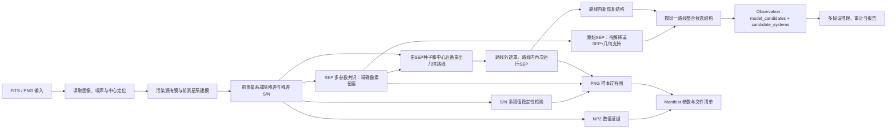

# LensAgent 视觉处理流程

这份文档是项目唯一的固定视觉流程说明。流程架构不会随样本变化，因此不再向每个对象的输出目录重复写入同一张流程图。

## 边界

- 视觉层负责记录“看到了什么、测量到什么”；
- 视觉层不直接输出透镜或非透镜结论；
- 原始SEP像素完整保存；若与合格路线一致则增加几何结构支持，否则作为待解释线索；
- 几何路径由SEP种子与中心后备模式共同提出；路线只提示再次搜索的位置；
- 路线内仍由SEP在真实残差/RMS上检测，路线本身不会被填成结构；
- 原始SEP与路线内新恢复结构没有天然优先关系，可按共同路线组成候选系统；
- 近中心和前景模型敏感性作为独立反证审计标记，不覆盖结构支持来源；
- 未经标定审计的`model_candidates`和`candidate_systems`不会晋级为后端评分使用的`structures`；
- 路线空白不等于环缺失，找到新像素段也不直接等于透镜证据；
- 每次样本运行只保存该样本实际产生的诊断图和过程图；
- 固定架构流程只在本文档维护一份。
