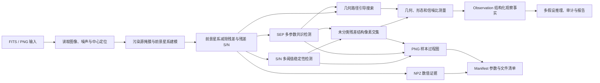

# LensAgent 视觉处理流程

这份文档是项目唯一的固定视觉流程说明。流程架构不会随样本变化，因此不再向每个对象的输出目录重复写入同一张流程图。

## 边界

- 视觉层负责记录“看到了什么、测量到什么”；
- 视觉层不直接输出透镜或非透镜结论；
- 几何路径由SEP结构优先提供种子，无种子时使用同模块的中心后备模式；路线只提示搜索位置，只有新恢复像素段才是观察事实；
- 路线空白不等于环缺失，找到新像素段也不直接等于透镜证据；
- 每次样本运行只保存该样本实际产生的诊断图和过程图；
- 固定架构流程只在本文档维护一份。
